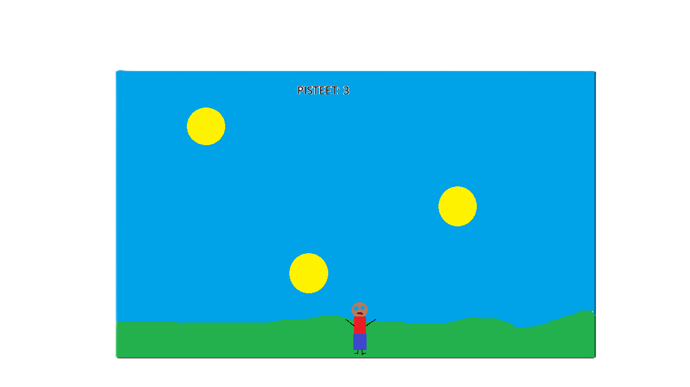

# Harjoitustyön suunnitelma

## Tietoja 

Tekijä: Minttu Lyytinen 

Työ git-varaston osoite: https://github.com/MinttuL/ohj1ht.git

Pelin nimi: Kukkienkeräilijä

Pelialusta: Windows

Pelaajien lukumäärä: 1

## Pelin tarina

Pelin hahmo (prinsessa) seikkailee pelialueella metsästäen taivaalta putoavia kukkia.

## Pelin idea ja tavoitteet

Kukkien keräily. Tavoitteena kerätä mahdollisimman paljon kukkia ja saada mahdollisimman korkea pistemäärä.

## Hahmotelma pelistä

## Toteutuksen suunnitelma

Lokakuu

- Pelin perusrakenne, pelialue ja pelaaja
- Pelaajan liikutus näytöllä
- Kukkien luominen ja putoaminen ylhäältä alas

Marraskuu

- Pelaajan ja kukkien törmäykset + pisteenlasku
- Lisään listan, silmukat ja tarvittavat aliohjelmat peliin
- Lisään ajastimen, pelin päättymisen ja viimeistelen pelin

Jos aikaa jää

- Lisään peliin erilaisia kerättäviä esineitä
- Teen pelistä haastavamman esimerkiksi nopeuttamalla kukkien putoamista
- Viimeistelen pelin ulkoasua ja käyttöliittymää
